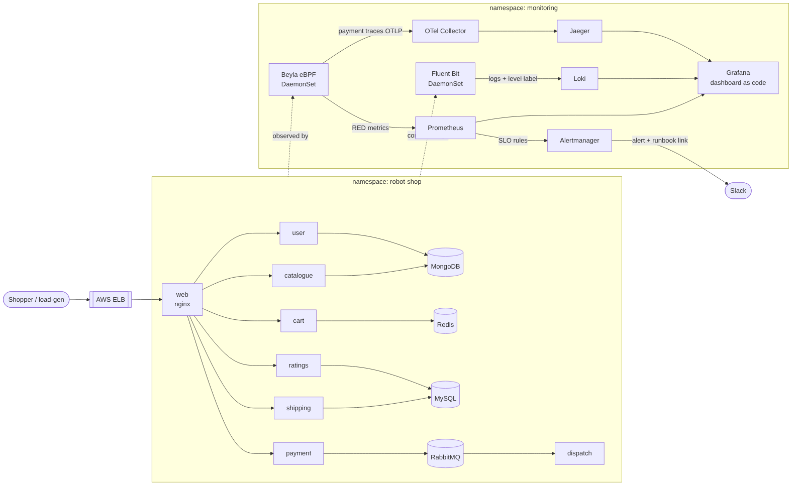

# Stan's Robot Shop: Keep It Running

**DevOps Capstone 2** by Peter O. Ajiboye. A dozen-service shop running on the [Capstone 1 EKS cluster](https://github.com/Subotich1/example-voting-app), made observable and held to an SLO.



| Signal | Tool | Where it is defined |
|---|---|---|
| Metrics (request rate, errors, latency) | Grafana Beyla (eBPF) to Prometheus | `observability/values/beyla.yaml` |
| Dashboard | Grafana, loaded from Git | `observability/dashboards/robot-shop-red.json` |
| Logs, searchable by service and level | Fluent Bit to Loki | `observability/values/fluent-bit.yaml`, `observability/values/loki.yaml` |
| Traces | Beyla to OpenTelemetry Collector to Jaeger | `observability/values/otel-collector.yaml`, `observability/manifests/jaeger.yaml` |
| SLO, alerts to Slack | Prometheus rules, Alertmanager | `observability/alerts/robot-shop-slo.yaml`, `docs/slo.md` |

## Why Beyla
Robot Shop's services only expose business metrics (items sold, cart value), not request, error or latency metrics. Its Node.js services run Node 14, which current OpenTelemetry SDKs no longer support. Beyla uses eBPF to observe HTTP traffic from the kernel, so every service gets the same RED metrics, and payment gets traces, **with no code changes**.

## What I changed in the shop
- Removed the Instana agent settings (`INSTANA_AGENT_HOST`, EUM key) from the Helm chart
- Pinned images to `2.1.0` instead of `latest`
- Redis uses the cluster's EBS gp3 storage class
- Load generator runs steady healthy traffic (`ERROR=0`); `ERROR=1` is used for drills

## Run it
Prerequisites: the Capstone 1 cluster (sized `3 x t3.large`), `kubectl`, `helm`, and a Slack incoming webhook.
```bash
read -rs SLACK_WEBHOOK_URL; export SLACK_WEBHOOK_URL   # paste the webhook, nothing is echoed
./scripts/install.sh shop      # Step 1: Robot Shop + load-gen
./scripts/install.sh metrics   # Step 2 + 5: Prometheus, Grafana, Beyla, dashboard, SLO alerts
./scripts/install.sh logs      # Step 3: Loki + Fluent Bit
./scripts/install.sh traces    # Step 4: OpenTelemetry Collector + Jaeger
```
Chart versions are pinned in `scripts/install.sh`. Open the UIs with the port-forward commands it prints.

Tear down before `terraform destroy`: `./scripts/uninstall.sh`

## Finding things
- **Dashboard:** Grafana > Dashboards > *Robot Shop: Requests, Errors, Latency*
- **Logs by service and level:** Grafana > Explore > Loki
  `{namespace="robot-shop", service="payment", level="error"}`
- **A trace:** Jaeger > Service `payment` > Find Traces

## SLO and incident response
- [SLO and error budget policy](docs/slo.md): 99% of requests to `web` succeed over 30 days
- [Runbook](docs/runbook.md), linked from every alert
- [Incident drill rehearsal](docs/incident-drill.md)
- [Blameless postmortem template](docs/postmortem-template.md)

The SLO alert is unit-tested with `promtool` (`observability/alerts/tests/`): it stays quiet under healthy traffic and fires after 2 minutes of sustained errors.

## Secrets
None in Git. The Slack webhook and Grafana admin password are created as Kubernetes Secrets by `install.sh` from your shell.

---
Original project README: [README-upstream.md](README-upstream.md)
